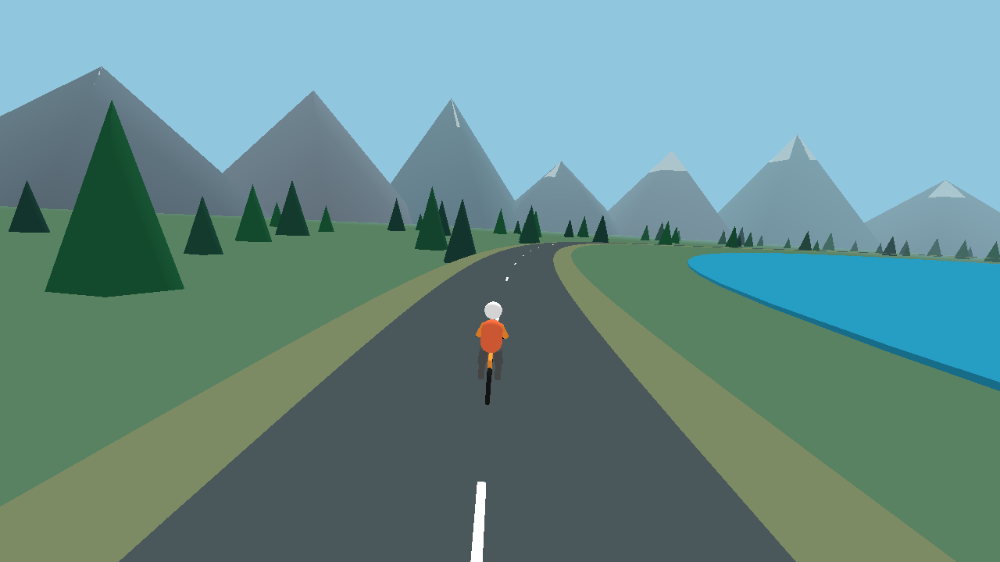

# Alpine Ride

An open source indoor cycling world for iPhone. No account, subscription, server, or analytics.

Alpine Ride is an early native SwiftUI and SceneKit prototype. Explore a stylized mountain lake or connect a Bluetooth cycling power sensor to move your rider by pedaling. The initial hardware target is the Wahoo KICKR CORE. Compatibility is not yet verified on physical trainer hardware.

## What works

* A local 3D lake loop, forest, mountains, and rider.
* Scenery preview without a trainer.
* Bluetooth Cycling Power Service discovery, device selection, and power notifications.
* Power-driven movement, pause/resume, and a three-second stale-data cutoff.
* Portrait and landscape display for iPhone and system screen mirroring.

## What is still missing

Automatic hill resistance, ERG workouts, cadence and heart rate displays, virtual shifting, ride saving, FIT export, multiplayer, and a calibrated cycling physics model. Visual speed and distance are approximate. The app reads power only and never writes resistance commands. Use a Garmin Edge or another controller for resistance and recording.

Build and simulator tests pass. Real trainer connectivity, TV mirroring, sustained performance, battery use, and heat still need device testing. This is not yet a finished Zwift or Rouvy replacement.

## Put it on your iPhone

1. Clone the repository and open `AlpineRide.xcodeproj` in Xcode 26 or newer with Swift 6.2 support.
2. Select the AlpineRide target, then Signing & Capabilities. Choose your own Apple Personal Team or developer team. Change the bundle identifier to one unique to you.
3. Connect your iPhone to the Mac, trust the Mac if prompted, and select it as the run destination. If Xcode requests Developer Mode, follow Apple's device instructions.
4. Press Run. Open Alpine Ride, select Enter Alpine Lake, then Explore scenery preview or Find trainer.

A free Apple Personal Team can install a development build on your own phone. Free provisioning expires after seven days, so rerun it from Xcode when required. There is no App Store or TestFlight release yet. Downloading source from GitHub alone does not install an iPhone app.

## Put it on your TV

On an AirPlay-compatible Roku, enable Settings → Apple AirPlay and HomeKit → AirPlay. Put the iPhone and TV on the same Wi-Fi, then choose the TV in iPhone Control Center → Screen Mirroring. Rotate the phone to landscape and resume the ride if opening Control Center paused it. Other AirPlay-compatible TVs can use the same iPhone screen-mirroring path. Roku's ordinary non-AirPlay screen mirroring is not compatible with iPhone.

## Development

The Xcode project is checked in. No third-party packages or backend setup are required. `project.yml` is its XcodeGen source; run `xcodegen generate` after changing project configuration.

Run tests with Product → Test in Xcode using an iPhone simulator. Tests cover signed power decoding, truncated packets, bounded motion, and rendering the world. The render test writes a preview image into the test app's temporary directory.

Hardware work should first establish reliable telemetry and mirroring. Trainer control should then use capability discovery, acknowledged ownership, command responses, and safe release. Receiving power does not prove resistance control works.

## Contributing

Issues and pull requests are welcome. For hardware reports, include iPhone model, iOS version, trainer model and firmware, and whether another app is connected. Do not post device identifiers, signing credentials, or personal health data. Keep improvements focused and include relevant simulator or hardware checks.

## License

MIT. Wahoo, Garmin, Roku, Zwift, and Rouvy are trademarks of their respective owners. This project is independent and is not affiliated with those companies.
